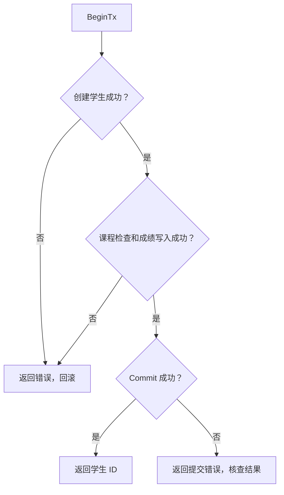
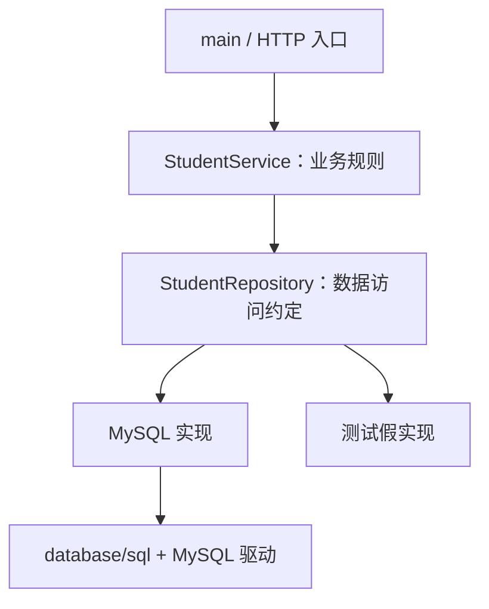

# 第八课：Go 数据库句柄与数据访问抽象

上一课，我们在 MySQL 命令行里建了 `school` 数据库，写过 `students`、`courses` 和 `scores` 三张表，也知道了一句 SQL 怎样经过解析、优化和执行。

但我们的后端还没有真正用上它们。用户提交一个学生的姓名和年龄，你总不能切到终端，手动替他敲一条 `INSERT`。

这节课就把两端接起来：**Go 程序怎样把 SQL 交给 MySQL，又怎样把结果变成业务代码能用的结构体？** 接通之后，再往上走一步：能不能让业务代码只说“保存学生”，不必到处重复写 SQL、处理 NULL、管理结果集？

## 第一部分：从命令行客户端换成 Go 程序

### 1. SQL 没变，发出 SQL 的人变了

上一课你在终端里写：

```sql
SELECT id, name FROM students WHERE id = 1;
```

现在 Go 程序也要做相同的事，只是多出了几个它必须自己处理的步骤：连接数据库、发送查询、接收结果、把字段转换成 Go 值，以及在失败时返回错误。

这里先分清三个角色：

| 角色           | 谁提供                | 负责什么                                         |
| -------------- | --------------------- | ------------------------------------------------ |
| `database/sql` | Go 标准库             | 统一的数据库访问 API、连接池、结果扫描、事务入口 |
| MySQL 驱动     | `go-sql-driver/mysql` | 实现 MySQL 通信协议，适配标准库的驱动接口        |
| MySQL 服务端   | 独立运行的数据库程序  | 解析和执行 SQL，管理表、索引、锁和日志           |

你可以把标准库想成前台：你用统一的方式提出请求。驱动负责把请求翻译成 MySQL 能听懂的协议；真正操作数据的是服务端。标准库里没有自带 MySQL 驱动，装了驱动也不等于装好了 MySQL 服务。

### 2. 什么叫“数据库句柄”

在 Go 里，最常见的数据库句柄是 `*sql.DB`。

“句柄”可以先理解成：**程序持有的一个对象，通过它操作背后的资源。** 它既不是整张数据库的内存副本，也不是一个文件路径。

更容易踩坑的是：`*sql.DB` 表示一个可并发使用的数据库访问入口，内部管理连接池，**不能把它等同于一条 TCP 连接**。

多个 goroutine 使用同一个 DB 入口；DB 从连接池中分配可用连接，由驱动与 MySQL 服务端通信。SQL 的执行以及表、索引、锁和日志的管理依然发生在数据库服务端。

连接会在需要时建立，未使用的连接可以被保留并复用，也可以因空闲、寿命到期或故障而关闭。暂时没有空闲连接，并且池子已经达到上限时，请求要等待别人归还连接。

可以类比图书馆借阅柜台：你保存的是“柜台入口”，不是永远占住其中一个窗口。

### 3. 这几个类型各自管什么

| 类型        | 含义                   | 生命周期要点                                 |
| ----------- | ---------------------- | -------------------------------------------- |
| `*sql.DB`   | 数据库访问入口和连接池 | 通常初始化一次，应用退出时关闭               |
| `*sql.Conn` | 从池中取出的专用连接   | 使用结束调用 Close，将连接归还给池           |
| `*sql.Tx`   | 绑定到一条连接的事务   | 用 Commit 或 Rollback 结束                   |
| `*sql.Rows` | 多行查询结果           | 及时读取并关闭，最后检查 Err                 |
| `*sql.Row`  | 单行查询结果           | 用 Scan 读取，并在那里检查错误               |
| `*sql.Stmt` | 预处理语句对象         | 不再使用时关闭；它不一定等于永久绑定一条连接 |

本课主要使用 DB、Row、Rows 和 Tx。只有需要连接级状态时才考虑 Conn，不必为日常 CRUD 手动取连接。

## 第二部分：先把数据库连起来

### 1. 新建项目，安装驱动

```bash
mkdir lesson8-demo
cd lesson8-demo
go mod init example.com/lesson8
go get github.com/go-sql-driver/mysql@v1.9.3
```

项目里这两种导入各有用途：

```go
import (
    "database/sql"
    _ "github.com/go-sql-driver/mysql"
)
```

下划线是空白导入：我们不直接使用驱动包里的名字，但需要导入时完成驱动注册。随后 `sql.Open("mysql", ...)` 才能找到名为 `mysql` 的驱动。

如果使用驱动提供的 `mysql.Config` 构造配置，就正常导入包并调用其方法即可，不需要同时再写一次空白导入。

### 2. DSN：把连接信息写清楚

DSN（Data Source Name）是驱动解释的连接配置字符串。本课使用：

```text
用户名:密码@tcp(主机:端口)/数据库名?参数
```

本地示例：

```text
root:你的本地密码@tcp(127.0.0.1:3306)/school?charset=utf8mb4&parseTime=true&loc=Asia%2FShanghai&timeout=3s&readTimeout=5s&writeTimeout=5s
```

| 配置                           | 含义                                                    |
| ------------------------------ | ------------------------------------------------------- |
| `tcp(127.0.0.1:3306)`          | 通过 TCP 连接本机的 MySQL                               |
| `/school`                      | 选中 school 数据库；不会替你创建它                      |
| `charset=utf8mb4`              | 使用 utf8mb4 连接字符集                                 |
| `parseTime=true`               | 让驱动把 DATE/DATETIME 等支持的日期值解析成 `time.Time` |
| `loc=Asia%2FShanghai`          | 为解析后的时间值指定地点；`/` 按查询参数规则编码        |
| `timeout=3s`                   | 建立连接的超时                                          |
| `readTimeout` / `writeTimeout` | 连接读写的超时                                          |

`loc` **不会修改 MySQL 的会话时区，也不会替你转换 DATETIME 存储的墙上时间**。DATETIME 本身没有时区，需要应用和数据库就“这些数值代表哪个时区”达成一致。本课按上海当地时间理解。

实际程序从环境变量或配置系统读取连接信息，不要把真实密码提交到仓库。如果 DSN 比较复杂，可以改用驱动的 `mysql.Config` 和 `FormatDSN()`，减少手写配置的错误。

### 3. `Open` 成功不代表服务器已经连上

这是本课第一个要记牢的区别：

- `sql.Open` 创建访问句柄，可能只完成驱动和配置检查；
- `PingContext` 获取或建立连接，检查当前是否能访问数据库。

因此启动时先 Open，再 Ping。即使启动检查成功，也只说明当时可用，后续每个操作仍然要处理错误。

完整的 `database.go`：

```go
package main

import (
	"context"
	"database/sql"
	"fmt"
	"time"

	_ "github.com/go-sql-driver/mysql"
)

func OpenMySQL(ctx context.Context, dsn string) (*sql.DB, error) {
	db, err := sql.Open("mysql", dsn)
	if err != nil {
		return nil, fmt.Errorf("open mysql: %w", err)
	}
	// These are classroom values, not a production tuning prescription.
	db.SetMaxOpenConns(10)
	db.SetMaxIdleConns(5)
	db.SetConnMaxIdleTime(time.Minute)
	db.SetConnMaxLifetime(3 * time.Minute)
	if err := db.PingContext(ctx); err != nil {
		_ = db.Close()
		return nil, fmt.Errorf("ping mysql: %w", err)
	}
	return db, nil
}
```

函数里的 `ctx` 从调用方传进来。连接检查失败时，函数关闭自己刚创建的句柄；成功时，把句柄的管理权交给调用方。

### 4. 连接池参数如何理解

| 方法                                | 控制内容                                    |
| ----------------------------------- | ------------------------------------------- |
| `SetMaxOpenConns(10)`               | 最多 10 条打开的连接，包括忙碌和空闲连接    |
| `SetMaxIdleConns(5)`                | 最多保留 5 条空闲连接，不是马上建出 5 条    |
| `SetConnMaxIdleTime(time.Minute)`   | 连接可以保持空闲的最长时间                  |
| `SetConnMaxLifetime(3*time.Minute)` | 连接允许被复用的最长寿命，不是 SQL 执行超时 |

这几项不是越大越好。数据库有自身的连接和处理能力，多实例部署时还要计算所有实例连接数的总和。上面的数字只是课堂示例，生产配置需要结合流量、数据库能力和 `db.Stats()` 观察。

句柄可以被多个 goroutine 共享使用，但不要据此推断一个 Tx、Rows 或底层连接也适合随意并行操作。业务数据的并发正确性依然要靠数据库约束、合适的 SQL 和事务设计保证。

### 5. 谁打开，谁在合适的时候关闭

通常在启动入口创建 `*sql.DB`，传给数据访问层。处理请求的函数负责关闭自己的结果集，不负责关闭整个池。

下面这个模式会给每次调用创建一个新池，不适合作为常规请求处理方式：

```go
// 反例：为每次查询创建和销毁一个连接池。
func handleRequest() {
    db, err := sql.Open("mysql", dsn)
    if err != nil {
        return
    }
    defer db.Close()
    // 再执行一次查询……
}
```

更合适的方式是创建一次，然后注入到使用它的对象中。启动位置可以持有它，查询函数只接收它。

## 第三部分：SQL 的结果怎样变成 Go 值

### 1. 三个入口，不要选错

| 需求                                        | 方法              | 返回值              | 错误在哪里检查                 |
| ------------------------------------------- | ----------------- | ------------------- | ------------------------------ |
| INSERT、UPDATE、DELETE 等不读取结果行的操作 | `ExecContext`     | `sql.Result, error` | 方法返回值，以及结果统计方法   |
| 预期读取一行                                | `QueryRowContext` | `*sql.Row`          | `Scan` 返回值                  |
| 读取零行或多行                              | `QueryContext`    | `*sql.Rows, error`  | 方法返回值、Scan、循环后的 Err |

这是按“是否需要读取返回行”分类。某些数据库支持写入语句返回行，此时也要按结果形式选择 API。本课的 MySQL CRUD 采用表里的用法。

### 2. 增：把值交给占位符

先看方法体里的关键几行，完整文件在后面给出：

```go
result, err := db.ExecContext(ctx,
    "INSERT INTO students (name, age, grade) VALUES (?, ?, ?)",
    name, age, grade,
)
if err != nil {
    return 0, fmt.Errorf("insert student: %w", err)
}
id, err := result.LastInsertId()
```

SQL 里的三个 `?` 和后面的三个参数按位置对应。变量不是直接拼进 SQL 文本，而是作为参数交给驱动。

`LastInsertId()` 取得本次插入生成的自增 ID，它自己也会返回错误。不要用 `SELECT MAX(id)` 推算新记录的 ID：其他连接可能正在插入数据。

`LastInsertId` 是否可用取决于驱动和数据库。本课的 MySQL 自增主键适用，不代表换成 PostgreSQL 后这段做法仍然原样成立。

### 3. 查一行：错误为什么在 Scan 才出现

```go
var id int64
var name string
err := db.QueryRowContext(ctx,
    "SELECT id, name FROM students WHERE id = ?", studentID,
).Scan(&id, &name)
```

`Scan` 的含义是：把结果中的列写入指定变量。

三个要求：

1. 参数数量和查询列数量对应；
2. 参数顺序和 SELECT 列顺序对应，不按结构体字段名自动匹配；
3. 传入可写入的目标，通常是变量的地址，类型要能接受数据库返回值。

这也解释了为什么不建议 `SELECT *`：表结构改变以后，扫描参数很容易对不上。

`QueryRowContext` 不单独返回 error，查询错误和扫描错误都在 `Scan` 里取得。查不到行时，Scan 返回 `sql.ErrNoRows`；它不同于连接失败或 SQL 语法错误。查询返回多行时，QueryRow 只扫描第一行，其他行会被丢弃，不会自动报告“结果超过一行”。按主键查可以避免这个歧义。

### 4. NULL 不是 Go 的零值

上一课的表允许 `age`、`grade` 和 `created_at` 为 NULL。即使 created_at 有默认值，显式写入 NULL 仍然可以产生 NULL。

```sql
INSERT INTO students (name, age, grade)
VALUES ('信息待补充', NULL, NULL);
```

直接把 NULL 扫描到 `int64` 或 `string` 会出问题。你也不能默认把 NULL 解释为 0 或空字符串——“年龄未知”和“年龄是 0”不是一件事。

标准库给出了一组带有效性标记的类型：

| SQL 数据   | 扫描目标         | 有效性判断                  |
| ---------- | ---------------- | --------------------------- |
| 可空整数   | `sql.NullInt64`  | `Valid` 为真才使用 `Int64`  |
| 可空字符串 | `sql.NullString` | `Valid` 为真才使用 `String` |
| 可空时间   | `sql.NullTime`   | `Valid` 为真才使用 `Time`   |

```go
var age sql.NullInt64
err := db.QueryRowContext(ctx,
    "SELECT age FROM students WHERE id = ?", studentID,
).Scan(&age)
if err != nil {
    return err
}
if age.Valid {
    fmt.Println("年龄:", age.Int64)
} else {
    fmt.Println("年龄尚未填写")
}
```

但业务层和 JSON 输出不一定需要知道 `sql.NullInt64`。本课在 Repository 内部使用 Null 类型，再把它们转换成指针：有值就返回指向该值的指针，NULL 就返回 nil。

`student.go` 同时定义业务数据、可识别的错误和后面要用的接口：

```go
package main

import (
	"context"
	"errors"
	"time"
)

type Student struct {
	ID        int64      `json:"id"`
	Name      string     `json:"name"`
	Age       *int64     `json:"age"`
	Grade     *string    `json:"grade"`
	CreatedAt *time.Time `json:"created_at"`
}

var (
	ErrStudentNotFound = errors.New("student not found")
	ErrInvalidStudent  = errors.New("invalid student")
	ErrCourseNotFound  = errors.New("course not found")
)

// The consumer declares the operations it needs.
type StudentRepository interface {
	Create(ctx context.Context, name string, age int64, grade string) (int64, error)
	GetByID(ctx context.Context, id int64) (Student, error)
	List(ctx context.Context, limit, offset int) ([]Student, error)
}
```

这里暂时只关注 Student。`Age` 为 nil 表示未知；指向 0 的指针表示确定是 0。JSON 输出分别是 `null` 和 `0`。NULL 的区别被保留下来，但数据库扫描类型被留在数据访问层里。

### 5. 查多行：别忘了循环之后的错误

读取多行是四步：取得 Rows、循环 Next、逐行 Scan、检查 Err。

```go
rows, err := db.QueryContext(ctx,
    "SELECT id, name FROM students ORDER BY id LIMIT ? OFFSET ?", 10, 0,
)
if err != nil {
    return err
}
defer rows.Close()

for rows.Next() {
    var id int64
    var name string
    if err := rows.Scan(&id, &name); err != nil {
        return err
    }
    fmt.Println(id, name)
}
if err := rows.Err(); err != nil {
    return err
}
```

为什么 Next 返回 false 以后还要看 Err？因为 false 有两种可能：正常读完，或者读取途中失败。比如数据库连接在第二行之后断开，你不能把前两行当成完整的查询结果返回。

Rows 通常会在正常读完时自动关闭；显式 `defer rows.Close()` 还能覆盖提前 return 的路径。**没有读取完也没有关闭的结果集，可能继续占用连接。** 连接池耗尽以后，新查询只能等待。

没有查到记录时：

- QueryRow 的 Scan 返回 `sql.ErrNoRows`；
- Query 的循环执行零次，检查 Err 没有问题，就返回一个空集合。

列表通常用 `make([]Student, 0)` 初始化，这样编码成 JSON 是 `[]`，而不是 nil 切片的 `null`。

### 6. 改与删：影响行数要按操作解释

```go
result, err := db.ExecContext(ctx,
    "UPDATE students SET age = ? WHERE id = ?", newAge, studentID,
)
if err != nil {
    return err
}
affected, err := result.RowsAffected()
```

`RowsAffected` 不是所有操作的通用“找到多少行”。MySQL 默认报告 UPDATE 实际改变的行数，如果年龄原来就是 18，再设置为 18，可能返回 0；id 不存在，也可能返回 0。不能只看这个值就断言学生不存在。

驱动的 `clientFoundRows=true` 可以把 UPDATE 计数改成匹配行数，但那是配置决定的语义，本课保持默认配置。需要区别这些情况时，要明确接口契约，再选择查询、事务或匹配行数方案。

按唯一主键 DELETE 时，返回 0 表示没有删除到记录，返回 1 表示删除了一行。本课的 Delete 返回 bool。这里仅删除没有关联成绩的演示学生；删除真实学生时，必须另外设计关联成绩的清理或保留规则。

### 7. 完整 CRUD 文件

把 SQL 和结果映射收进 `MySQLStudentRepository`。虽然下一部分才正式解释 Repository，这里先把它理解成“专门操作 students 表的对象”。

完整的 `repository.go`：

```go
package main

import (
	"context"
	"database/sql"
	"errors"
	"fmt"
)

type MySQLStudentRepository struct {
	db *sql.DB
}

func NewMySQLStudentRepository(db *sql.DB) *MySQLStudentRepository {
	return &MySQLStudentRepository{db: db}
}

var _ StudentRepository = (*MySQLStudentRepository)(nil)

func (r *MySQLStudentRepository) Create(ctx context.Context, name string, age int64, grade string) (int64, error) {
	result, err := r.db.ExecContext(ctx,
		"INSERT INTO students (name, age, grade) VALUES (?, ?, ?)",
		name, age, grade,
	)
	if err != nil {
		return 0, fmt.Errorf("insert student: %w", err)
	}
	id, err := result.LastInsertId()
	if err != nil {
		return 0, fmt.Errorf("get inserted id: %w", err)
	}
	return id, nil
}

// sql.Row and sql.Rows both provide Scan; this interface only shares row mapping.
type rowScanner interface {
	Scan(dest ...any) error
}

func scanStudent(row rowScanner) (Student, error) {
	var s Student
	var age sql.NullInt64
	var grade sql.NullString
	var createdAt sql.NullTime
	if err := row.Scan(&s.ID, &s.Name, &age, &grade, &createdAt); err != nil {
		return Student{}, err
	}
	if age.Valid {
		value := age.Int64
		s.Age = &value
	}
	if grade.Valid {
		value := grade.String
		s.Grade = &value
	}
	if createdAt.Valid {
		value := createdAt.Time
		s.CreatedAt = &value
	}
	return s, nil
}

func (r *MySQLStudentRepository) GetByID(ctx context.Context, id int64) (Student, error) {
	row := r.db.QueryRowContext(ctx,
		"SELECT id, name, age, grade, created_at FROM students WHERE id = ?",
		id,
	)
	s, err := scanStudent(row)
	if errors.Is(err, sql.ErrNoRows) {
		return Student{}, ErrStudentNotFound
	}
	if err != nil {
		return Student{}, fmt.Errorf("get student: %w", err)
	}
	return s, nil
}

func (r *MySQLStudentRepository) List(ctx context.Context, limit, offset int) ([]Student, error) {
	if limit < 1 || limit > 100 || offset < 0 {
		return nil, fmt.Errorf("invalid pagination: limit=%d offset=%d", limit, offset)
	}
	rows, err := r.db.QueryContext(ctx,
		"SELECT id, name, age, grade, created_at FROM students ORDER BY id LIMIT ? OFFSET ?",
		limit, offset,
	)
	if err != nil {
		return nil, fmt.Errorf("list students: %w", err)
	}
	defer rows.Close()

	students := make([]Student, 0)
	for rows.Next() {
		s, err := scanStudent(rows)
		if err != nil {
			return nil, fmt.Errorf("scan student: %w", err)
		}
		students = append(students, s)
	}
	if err := rows.Err(); err != nil {
		return nil, fmt.Errorf("iterate students: %w", err)
	}
	return students, nil
}

func (r *MySQLStudentRepository) UpdateAge(ctx context.Context, id, age int64) (int64, error) {
	if age < 0 || age > 150 {
		return 0, ErrInvalidStudent
	}
	result, err := r.db.ExecContext(ctx,
		"UPDATE students SET age = ? WHERE id = ?", age, id,
	)
	if err != nil {
		return 0, fmt.Errorf("update student: %w", err)
	}
	n, err := result.RowsAffected()
	if err != nil {
		return 0, fmt.Errorf("get updated count: %w", err)
	}
	// With the default MySQL DSN, 0 may also mean the value was unchanged.
	return n, nil
}

func (r *MySQLStudentRepository) Delete(ctx context.Context, id int64) (bool, error) {
	result, err := r.db.ExecContext(ctx, "DELETE FROM students WHERE id = ?", id)
	if err != nil {
		return false, fmt.Errorf("delete student: %w", err)
	}
	n, err := result.RowsAffected()
	if err != nil {
		return false, fmt.Errorf("get deleted count: %w", err)
	}
	return n > 0, nil
}
```

几个值得回头看的地方：

- `rowScanner` 是只有 Scan 的小接口。Row 和 Rows 都满足它，所以单行和多行读取共享 `scanStudent`；这只统一行映射，不涉及 SQL 生成。
- GetByID 把 `sql.ErrNoRows` 转成业务能识别的 `ErrStudentNotFound`，其他错误通过 `%w` 保留原始错误链。
- List 显式排序、限制单页大小，并拒绝非法 offset。分页时没有稳定排序，结果就可能出现重复或遗漏；即使按 id 排序，并发数据变动下 OFFSET 分页也不承诺跨页快照一致。
- UpdateAge 和 Delete 是实现提供的额外方法，暂时没有放进业务层接口。接口只列出当前消费者需要的操作。

## 第四部分：查询不能无限等待

### 1. context 是这次操作的生命周期

先把 context 当成随调用向下传递的信号：这次工作有没有被取消，最晚要在什么时候结束。

```go
ctx, cancel := context.WithTimeout(context.Background(), 2*time.Second)
defer cancel()

student, err := repo.GetByID(ctx, 1)
```

这里建立一个最多存活 2 秒的操作上下文。用完调用 cancel，释放定时器等相关资源。查询超时也可能发生在等连接阶段，而不一定是 SQL 本身执行了 2 秒。

在 HTTP 服务里，应以请求的 context 为起点：

```go
ctx, cancel := context.WithTimeout(r.Context(), 2*time.Second)
defer cancel()
student, err := repo.GetByID(ctx, studentID)
```

如果在数据层每次都重新用 Background，就切断了调用方的取消信号。用户请求结束了，数据库操作仍可能继续等。

### 2. 连接超时和操作超时是不同的控制项

DSN 的 timeout 管建连，readTimeout/writeTimeout 管网络读写；Context 给这次调用传递取消和截止时间。两者都值得设置，不能把连接寿命 `SetConnMaxLifetime` 当成它们的替代品。

取消能否及时生效也受驱动支持影响。本课的 MySQL 驱动支持 Context；取消或超时可能使底层连接被关闭并从池中淘汰。客户端超时不等于你已经确定服务端写入没发生，尤其是提交期间连接中断时，不能直接无条件重试写入。

如果借连接时经常超时，先检查 Rows 是否关闭、事务是否结束、慢 SQL 或锁等待，以及 `db.Stats()` 的 InUse、WaitCount 和 WaitDuration。没有测量就扩大连接池，可能只是把压力转移给数据库。

## 第五部分：把上一课的事务真正用起来

### 1. 一条操作成功，不代表整个业务完成

假设业务是“创建学生，同时录入第一门课的成绩”。它至少需要两条 INSERT：

```sql
INSERT INTO students (name, age, grade) VALUES (...);
INSERT INTO scores (student_id, course_id, score) VALUES (...);
```

学生插入成功、成绩插入失败，系统就停在只完成一半的状态。业务希望两个写入作为一个整体，所以需要事务。

上一课介绍了原子性，这里补上一条边界：**把 SQL 放进事务，并不自动让所有并发业务规则成立。** 比如库存扣减还需要条件更新或适当的锁；事务不会替你检查库存是否非负。本课解决的是这组学生与成绩写入的整体提交。

### 2. 事务必须绑定到同一条连接

下面是反例，不要拿它管理事务：

```go
// 反例：每次 db.ExecContext 都可能使用池里的不同连接。
db.ExecContext(ctx, "BEGIN")
db.ExecContext(ctx, "INSERT INTO students (name) VALUES (?)", "小明")
db.ExecContext(ctx, "COMMIT")
```

`*sql.DB` 是池的入口，不能保证这三次操作发生在同一条连接上。正确做法是 `db.BeginTx` 得到 `*sql.Tx`，事务里的每条查询和写入都通过这个 tx 执行。

### 3. 一个包含回滚路径的完整例子

lesson7 没有在 scores 上建立物理外键，本例显式检查课程，并用 MySQL 8 的 `FOR SHARE` 在事务期间锁定该课程行，避免检查之后被其他事务删除。

这个检查只保护本次事务期间的关联。事务结束之后，其他删除课程或学生的入口仍需遵守同一套关联规则；需要数据库强制保护时，应另外设计物理外键及删除策略。

为了课堂观察回滚，例子特意先插入学生，再检查课程。日常业务如果能够提前发现输入错误，应尽早校验，缩短事务。

完整的 `transaction.go`：

```go
package main

import (
	"context"
	"database/sql"
	"errors"
	"fmt"
)

func CreateStudentWithScore(ctx context.Context, db *sql.DB, name string, age int64, grade string, courseID, score int64) (int64, error) {
	name, grade, err := normalizeStudent(name, age, grade)
	if err != nil {
		return 0, fmt.Errorf("validate student: %w", err)
	}
	if courseID <= 0 || score < 0 || score > 100 {
		return 0, fmt.Errorf("invalid course id or score")
	}
	tx, err := db.BeginTx(ctx, nil)
	if err != nil {
		return 0, fmt.Errorf("begin transaction: %w", err)
	}
	// Fallback for every return path, including panic; after Commit it returns ErrTxDone.
	defer tx.Rollback()

	result, err := tx.ExecContext(ctx,
		"INSERT INTO students (name, age, grade) VALUES (?, ?, ?)", name, age, grade,
	)
	if err != nil {
		return 0, fmt.Errorf("insert student in transaction: %w", err)
	}
	id, err := result.LastInsertId()
	if err != nil {
		return 0, fmt.Errorf("get inserted id in transaction: %w", err)
	}

	// lesson7 has no physical foreign key. Check and lock the referenced course.
	// This is intentionally after INSERT so a missing course demonstrates rollback.
	var existingCourseID int64
	err = tx.QueryRowContext(ctx, "SELECT id FROM courses WHERE id = ? FOR SHARE", courseID).Scan(&existingCourseID)
	if errors.Is(err, sql.ErrNoRows) {
		return 0, ErrCourseNotFound
	}
	if err != nil {
		return 0, fmt.Errorf("check course: %w", err)
	}
	if _, err := tx.ExecContext(ctx,
		"INSERT INTO scores (student_id, course_id, score) VALUES (?, ?, ?)", id, courseID, score,
	); err != nil {
		return 0, fmt.Errorf("insert score: %w", err)
	}
	if err := tx.Commit(); err != nil {
		return 0, fmt.Errorf("commit transaction: %w", err)
	}
	return id, nil
}
```

事务的生命周期可以这样看：



为什么一开始就写 `defer tx.Rollback()`？这样后面任何一步提前返回，都有回滚收尾；提交成功后，延迟回滚返回 `sql.ErrTxDone`，不会把已经提交的数据撤销。本例把它作为回滚兜底，因此没有使用这个返回值；生产中可以按需要记录真正的回滚异常。

`Commit` 也必须检查错误。提交出错时不能向用户报告成功；尤其在网络异常场景中，客户端可能无法确认服务端是否已经提交，后续应靠业务标识和核查处理，而不是盲目重试。

### 4. 最常见的事务错误：一半 tx，一半 db

```go
tx, err := db.BeginTx(ctx, nil)
// 检查 err，安排 Rollback……
tx.ExecContext(ctx, "INSERT INTO students (name) VALUES (?)", "小明")
db.ExecContext(ctx, "INSERT INTO scores (...) VALUES (...)") // 错误：在事务外
```

第二条不属于这个事务，回滚 tx 无法撤销它。如果连接池最大连接数为 1，事务已经占了唯一连接，事务内再调用 db 还可能一直等不到连接。

不要在事务里发 HTTP 请求、等用户输入或进行很慢的文件操作；否则连接和锁都可能被长时间占住。普通 CRUD 不需要为了“看起来规范”一律包上显式事务，事务边界应服务于实际业务原子性。

### 5. 观察回滚时，自增 ID 不会“倒带”

在本地练习库中找一个确认不存在的正整数课程 ID，比如先确认下面查询为空：

```sql
SELECT id FROM courses WHERE id = 2147483647;
SELECT COUNT(*) FROM students WHERE name = 'lesson8回滚示例';
```

临时在 main 的 run 函数中调用：

```go
_, err = CreateStudentWithScore(ctx, db,
    "lesson8回滚示例", 18, "大一", 2147483647, 90,
)
if !errors.Is(err, ErrCourseNotFound) {
    return fmt.Errorf("expected missing course, got %v", err)
}
```

再次查这个名字的记录数量，应该和操作前相同。然后换成存在的课程 ID，观察学生和成绩同时写入。

回滚可以撤销数据写入，但自增 ID 可能已经被消耗，出现空洞正常。不能把“下一条 ID 没有接上”误判成回滚失败。

## 第六部分：给上层提供一个统一的数据访问接口

### 1. 为什么已经会写 SQL，还要封装

现在设想一个 Web 接口：它接收姓名和年龄、判断输入是否合法、写 INSERT、取 ID、处理 MySQL 错误，再返回 JSON。

一开始写在一个函数里很方便，但第二个入口——比如批量导入——也要注册学生，第三个入口也要查询学生。很快 SQL、错误判断和 Scan 会复制到多个地方。

这里有两件不同的工作：

- **业务层（Service）：**决定“能不能做、应该做什么”，比如名字不能为空、年龄必须合理；
- **数据访问层（Repository，也常见 DAO 命名）：**决定“怎样读写数据”，比如使用哪条 SQL、怎样扫描 NULL、怎样解释查无记录。

本课只建立这两层，入口由 main 代替，不需要引入复杂架构。

### 2. 标准库的统一，与业务层的统一，不是一回事

`database/sql` 已经统一了 Exec、Query 等调用形式，但上层业务仍然不应该依赖表字段、SQL 方言和 Scan 细节。

我们希望业务说的是：

```go
id, err := repo.Create(ctx, name, age, grade)
```

而不是“用 MySQL 的三个问号占位符插入 students 表，再取得 LastInsertId”。前者表达数据访问能力，后者是某个实现的细节。

`student.go` 中定义的接口正是在描述这些能力：

```go
type StudentRepository interface {
    Create(ctx context.Context, name string, age int64, grade string) (int64, error)
    GetByID(ctx context.Context, id int64) (Student, error)
    List(ctx context.Context, limit, offset int) ([]Student, error)
}
```

接口除了方法签名，还需要约定行为：Create 成功返回新 ID；GetByID 找不到时返回可用 `errors.Is` 识别的 `ErrStudentNotFound`；List 没数据返回空切片；失败返回错误，不把失败伪装成空结果。

### 3. 用 Go 接口实现，不需要继承

MySQLStudentRepository 定义了接口要求的这些方法，就自动实现 StudentRepository，不用写 `implements`。

文件中的这一行是编译期检查，不会真的创建或使用一个 nil 仓库：

```go
var _ StudentRepository = (*MySQLStudentRepository)(nil)
```

再写一个 Service，让它只持有接口。完整的 `service.go`：

```go
package main

import (
	"context"
	"fmt"
	"strings"
	"unicode/utf8"
)

type StudentService struct {
	repo StudentRepository
}

func NewStudentService(repo StudentRepository) *StudentService {
	return &StudentService{repo: repo}
}

func normalizeStudent(name string, age int64, grade string) (string, string, error) {
	name = strings.TrimSpace(name)
	grade = strings.TrimSpace(grade)
	if name == "" || utf8.RuneCountInString(name) > 50 ||
		grade == "" || utf8.RuneCountInString(grade) > 10 || age < 0 || age > 150 {
		return "", "", ErrInvalidStudent
	}
	return name, grade, nil
}

func (s *StudentService) Register(ctx context.Context, name string, age int64, grade string) (int64, error) {
	name, grade, err := normalizeStudent(name, age, grade)
	if err != nil {
		return 0, fmt.Errorf("register student: %w", err)
	}
	id, err := s.repo.Create(ctx, name, age, grade)
	if err != nil {
		return 0, fmt.Errorf("register student: %w", err)
	}
	return id, nil
}
```

注意 Register 里没有 SQL，也没有 `*sql.DB`。去掉姓名两端的空白、判断年龄范围是业务规则；把数据放进 MySQL 是 Repository 的工作。

年龄范围 0～150、姓名长度 50、年级长度 10 是课堂示例规则。实际项目按需求定义，并考虑字符集、字符计数和数据库约束的一致性。

### 4. 构造函数把依赖接起来

```go
repo := NewMySQLStudentRepository(db)
service := NewStudentService(repo)
id, err := service.Register(ctx, "小明", 18, "大一")
```

这就是最朴素的依赖注入：创建对象时，把它需要的依赖传进去。无需专门的注入框架，也不必让每个包都去读取一个全局 db。

选择一个内存实现或测试假实现时，替换传入的 repo 即可。上层算法不必跟着改。



这里的统一是**让上层依赖稳定的业务数据访问约定**，不是消除所有数据库差异。换数据库后，SQL、占位符、自增 ID、事务隔离等仍要由对应实现调整，并验证语义一致。

### 5. 接口为什么能让测试变简单

要测试“空名字不能注册”，没必要启动 MySQL。测试假实现只要实现接口，并记录 Create 有没有被调用即可。

附录给出了完整的 `service_test.go`，验证三个行为：

1. 输入非法时，返回 ErrInvalidStudent，而且不访问仓库；
2. 名字两端空白被去掉后，再交给仓库；
3. 仓库失败时，业务层保留原始错误链。

这些测试只验证业务层，不能证明 SQL 正确、MySQL 连接成功或事务能回滚。数据访问层还需要真实数据库集成验证。

接口不需要一上来设计成几十个方法。谁使用接口，就围绕谁需要的能力定义小接口；本课暂时没有业务调用 UpdateAge、Delete，所以没有强迫所有替代实现都提供它们。

### 6. 进阶阅读：让 DB 和 Tx 复用数据访问代码

上面的事务示例单独写了 SQL，目的是先讲清事务生命周期。项目里重复逻辑变多以后，可以提取 DB 和 Tx 的共同方法：

```go
// 进阶示意：在 repository.go 中使用；不是需要额外复制的主线代码。
type DBTX interface {
    ExecContext(context.Context, string, ...any) (sql.Result, error)
    QueryContext(context.Context, string, ...any) (*sql.Rows, error)
    QueryRowContext(context.Context, string, ...any) *sql.Row
}

type SQLStudentRepository struct {
    q DBTX
}

func NewSQLStudentRepository(q DBTX) *SQLStudentRepository {
    return &SQLStudentRepository{q: q}
}
```

将方法中的 `r.db.ExecContext` 等改成 `r.q.ExecContext` 后，普通操作注入 db，事务内操作注入 tx，就能复用这些数据访问方法。因为 `*sql.DB` 和 `*sql.Tx` 都提供接口中的方法。

事务场景下，BeginTx 仍由持有 db 的协调代码负责；它创建绑定到 tx 的仓库，交给相关步骤，最后提交或回滚。**注入了 db 的原有仓库不会自动变成事务仓库。** 事务仓库也不应逃逸出该事务的生命周期。

DBTX 统一的是 SQL 执行入口，StudentRepository 统一的是上层业务需要的能力。这两种接口分别解决不同的问题；基础练习掌握后者就足够。

### 7. ORM 应该放在哪里

如果将来选择 ORM，可以把它放在 Repository 实现内部，让上层继续调用 Create/GetByID 等方法。本课先使用原生 SQL，是为了看清资源管理、参数绑定和事务边界；使用 ORM 后这些职责仍然需要理解。

不要为了封装而提前写“任意表通用 CRUD 框架”。先把学生这一个实际需求的接口、错误和行为说明白，再根据真正出现的重复提取抽象。

## 第七部分：安全使用参数，以及预处理语句

### 1. SQL 注入来自把输入当代码

反例：

```go
query := fmt.Sprintf("SELECT id, name FROM students WHERE name = '%s'", name)
```

如果名字包含引号和 SQL 片段，它就可能改变原来查询的含义。正确做法是：

```go
rows, err := db.QueryContext(ctx,
    "SELECT id, name FROM students WHERE name = ?", name,
)
```

占位符用于数据值。参数里带引号、分号或 SQL 关键词，也应该作为值处理，不由你自己拼接和转义。

`?` 是本课 MySQL 驱动的占位符形式；PostgreSQL 驱动常用 `$1`、`$2`，不能认为标准库会把方言自动转换。

### 2. 列名和排序方向不能当普通参数

`ORDER BY ?` 加一个字符串参数，不会把它变成可信的列名。表名、列名、ASC/DESC 等 SQL 结构应该用固定代码或白名单选择：

```go
orderBy := "id ASC"
switch sortKey {
case "age_desc":
    orderBy = "age DESC, id ASC"
case "name_asc":
    orderBy = "name ASC, id ASC"
}
// orderBy 只能来自上面的固定字面量，不能改成用户输入本身。
query := "SELECT id, name FROM students ORDER BY " + orderBy + " LIMIT ?"
rows, err := db.QueryContext(ctx, query, limit)
```

示意代码后面仍要按第三部分的规则处理 err、扫描、关闭和检查 Rows.Err。

### 3. 参数化不等于必须先显式 Prepare

普通 CRUD 直接调用带参数的 ExecContext/QueryContext 就可以安全地绑定值。显式预处理主要在重复使用同一语句等场景考虑，不是每条 SQL 的必经步骤，也不保证一定更快。

```go
stmt, err := db.PrepareContext(ctx,
    "INSERT INTO students (name, age, grade) VALUES (?, ?, ?)",
)
if err != nil {
    return err
}
defer stmt.Close()

for _, name := range []string{"小明", "小红"} {
    if _, err := stmt.ExecContext(ctx, name, 18, "大一"); err != nil {
        return err
    }
}
```

这个示例只说明语句复用，两次写入**没有**因此获得整体原子性。如果要求两条都成功或都撤销，应先开启事务，再在 tx 上 Prepare，并在最后提交。

## 第八部分：把示例完整运行一次

### 1. 项目文件清单

本讲义的主线代码按以下文件名保存到同一目录，包名统一为 main：

| 文件              | 内容来源 | 用途                     |
| ----------------- | -------- | ------------------------ |
| `database.go`     | 第二部分 | 连接和连接池初始化       |
| `student.go`      | 第三部分 | 数据结构、接口、业务错误 |
| `repository.go`   | 第三部分 | CRUD 与扫描映射          |
| `transaction.go`  | 第五部分 | 创建学生与成绩的事务     |
| `service.go`      | 第六部分 | 注册学生的业务逻辑       |
| `main.go`         | 本部分   | 组装对象并演示 CRUD      |
| `service_test.go` | 附录     | 无数据库的业务测试       |

前面用于解释的片段、反例和 DBTX 进阶示意不用额外复制。配套示例压缩包已经包含这些完整文件。

完整的 `main.go`：

```go
package main

import (
	"context"
	"encoding/json"
	"errors"
	"flag"
	"fmt"
	"log"
	"os"
	"time"
)

func main() {
	withScore := flag.Bool("with-score", false, "also create a student and a score for course 10")
	flag.Parse()
	if err := run(*withScore); err != nil {
		log.Print(err)
		os.Exit(1)
	}
}

func run(withScore bool) error {
	dsn := os.Getenv("MYSQL_DSN")
	if dsn == "" {
		return fmt.Errorf("please set MYSQL_DSN")
	}
	ctx, cancel := context.WithTimeout(context.Background(), 30*time.Second)
	defer cancel()
	connectCtx, connectCancel := context.WithTimeout(ctx, 5*time.Second)
	db, err := OpenMySQL(connectCtx, dsn)
	connectCancel()
	if err != nil {
		return err
	}
	defer db.Close()

	repo := NewMySQLStudentRepository(db)
	service := NewStudentService(repo)
	id, err := service.Register(ctx, " lesson8示例 ", 18, "大一")
	if err != nil {
		return err
	}
	fmt.Println("新增学生 ID:", id)
	student, err := repo.GetByID(ctx, id)
	if err != nil {
		return err
	}
	data, err := json.Marshal(student)
	if err != nil {
		return err
	}
	fmt.Println("查询:", string(data))
	students, err := repo.List(ctx, 5, 0)
	if err != nil {
		return err
	}
	fmt.Println("第一页数量:", len(students))
	n, err := repo.UpdateAge(ctx, id, 19)
	if err != nil {
		return err
	}
	fmt.Println("更新影响行数:", n)
	deleted, err := repo.Delete(ctx, id)
	if err != nil {
		return err
	}
	fmt.Println("删除成功:", deleted)
	if _, err := repo.GetByID(ctx, id); !errors.Is(err, ErrStudentNotFound) {
		return fmt.Errorf("expected ErrStudentNotFound after delete, got %v", err)
	}
	fmt.Println("删除后查询: student not found")

	if withScore {
		id, err := CreateStudentWithScore(ctx, db, "lesson8事务示例", 18, "大一", 10, 90)
		if err != nil {
			return err
		}
		fmt.Println("事务新增学生 ID:", id)
	}
	return nil
}
```

这里用 run 函数持有 db，让函数返回时先执行 `defer db.Close()`，再由 main 处理退出状态。`log.Fatal` 和 `os.Exit` 不执行当前尚未运行的 defer，不能把它们随意放在刚打开资源的函数里。

为了演示简单，run 共享一个 30 秒的整体上下文，启动 Ping 再使用一个 5 秒子上下文。真实 HTTP 服务应由每个请求传入自己的 Context，不是整台服务器共享一个 30 秒 Context。

### 2. 准备 lesson7 的表

如果已经完成上一课，直接复用 school 库和三张表即可。还没有建表，可以在本地练习库执行 `schema.sql`：

```sql
-- Run only against your local classroom database. Existing lesson7 tables are reused.
CREATE DATABASE IF NOT EXISTS school CHARACTER SET utf8mb4;
USE school;

CREATE TABLE IF NOT EXISTS students (
    id         INT PRIMARY KEY AUTO_INCREMENT,
    name       VARCHAR(50) NOT NULL,
    age        INT,
    grade      VARCHAR(10),
    created_at DATETIME DEFAULT CURRENT_TIMESTAMP
) ENGINE=InnoDB;

CREATE TABLE IF NOT EXISTS courses (
    id    INT PRIMARY KEY AUTO_INCREMENT,
    title VARCHAR(50) NOT NULL
) ENGINE=InnoDB;

CREATE TABLE IF NOT EXISTS scores (
    student_id INT NOT NULL,
    course_id  INT NOT NULL,
    score      INT,
    PRIMARY KEY (student_id, course_id)
) ENGINE=InnoDB;
```

这些语句不会重建已存在的表，也不会删除数据，但 `IF NOT EXISTS` 不会替你修正旧表结构。请确认旧表字段与上一课一致，三张表都使用 InnoDB；可通过 `SHOW CREATE TABLE students` 等检查。

要运行课程 10 的事务演示，先检查：

```sql
SELECT id, title FROM courses WHERE id = 10;
```

如果没有记录，再执行：

```sql
INSERT INTO courses (id, title) VALUES (10, '数学');
```

默认 CRUD 演示会创建并删除自己新增的学生；`-with-score` 演示会保留新增学生及成绩，用于之后观察，重复运行会新增记录。都只在本地练习库操作。

### 3. 设置环境变量

macOS / Linux / Git Bash：

```bash
export MYSQL_DSN='root:替换为你的本地密码@tcp(127.0.0.1:3306)/school?charset=utf8mb4&parseTime=true&loc=Asia%2FShanghai&timeout=3s&readTimeout=5s&writeTimeout=5s'
```

Windows PowerShell：

```powershell
$env:MYSQL_DSN = 'root:替换为你的本地密码@tcp(127.0.0.1:3306)/school?charset=utf8mb4&parseTime=true&loc=Asia%2FShanghai&timeout=3s&readTimeout=5s&writeTimeout=5s'
```

实际密码如果含有 shell 引号等特殊字符，要按所用 shell 的规则设置，或通过本机配置方式传入。不要把包含密码的命令截图提交到作业仓库。

### 4. 安装依赖、测试、运行

如果使用配套示例包，它已有 go.mod，直接执行：

```bash
go mod tidy
go test ./...
go run .
```

手动创建项目时，按第二部分的命令初始化模块，复制主线文件，然后执行上述命令。使用 `go run .`，这样会编译整个目录；`go run main.go` 不会自动包含这里拆分的其他源文件。

预期输出大致如下，ID、时间、第一页数量随数据库现状变化：

```text
新增学生 ID: 6
查询: {"id":6,"name":"lesson8示例","age":18,"grade":"大一","created_at":"2026-10-09T21:00:00+08:00"}
第一页数量: 5
更新影响行数: 1
删除成功: true
删除后查询: student not found
```

准备好课程 10 后，再运行：

```bash
go run . -with-score
```

观察事务写入结果，不要假设学生 ID 从 1 开始；用程序输出的 ID 查询：

```sql
SELECT s.id, s.name, c.title, sc.score
FROM students AS s
JOIN scores AS sc ON sc.student_id = s.id
JOIN courses AS c ON c.id = sc.course_id
WHERE s.id = 这里替换为输出的学生ID;
```

最后这条 SQL 中的中文是需要手动替换的说明，不是可直接执行的标识符。

## 课内练习

### 练习 1：连接句柄的生命周期

按示例连接数据库，分别尝试正确配置、错误端口、错误数据库名。记录 Open 和 Ping 在哪里返回错误，确认错误路径不会把 db 返回给上层。

验收：能解释 db 为什么共享、QueryRow 为什么不能省略 Scan，以及 db.Close 应该放在哪里。

### 练习 2：NULL 和空结果

往 students 插入一条 age、grade、created_at 都为 NULL 的记录，通过 GetByID 和 List 读取；再查询一个不存在的学生。

验收：可空字段保留为 nil；不存在学生返回 ErrStudentNotFound；空列表不是连接错误。使用 JSON 时 NULL 不会被误写成 0 或空字符串。

### 练习 3：按年级查询学生

新增 `ListByGrade(ctx, grade, limit, offset)`，SQL 用占位符传年级、limit 和 offset，固定按 id 排序，并限制单页大小。

验收：参数带引号仍正常处理，空结果返回空切片，所有提前返回路径都能释放 Rows，迭代结束检查 Err。

### 练习 4：亲眼观察事务回滚

使用第五部分的不存在课程 ID；记录调用前后该示例姓名的数量。再换成存在课程 ID，检查 students 与 scores 的关联记录。

验收：失败时学生与成绩都没有新增；成功时两张表同时新增；Commit 的错误不能被忽略。

### 练习 5：业务层不访问数据库

为 StudentService 增加查询学生的方法，并用测试假实现分别模拟成功、未找到和存储异常。返回业务错误时继续使用 `%w` 和 `errors.Is`。

验收：测试不启动 MySQL，也不创建 `*sql.DB`；Service 中没有 SQL 文本；假实现返回错误时不会被当成成功。

### 挑战题：连接池耗尽是怎么发生的

在单独的本地实验中把最大连接数设为 1；启动一个返回多行的查询，既不完整读取，也不关闭 Rows，然后发出第二个带短超时的查询。观察它是否需要等待，再关闭第一次的 Rows 重试。

结果受到驱动读取和 Context 生命周期影响，不必强求第一次实验都卡住。也可以改用 `db.Conn(ctx)` 显式持有唯一连接，再运行第二个查询，现象更确定；实验结束必须关闭 Conn。

验收：解释为什么“数据库 SQL 很快，但应用仍然等连接”，以及仅增大池子不能修复资源泄漏。

